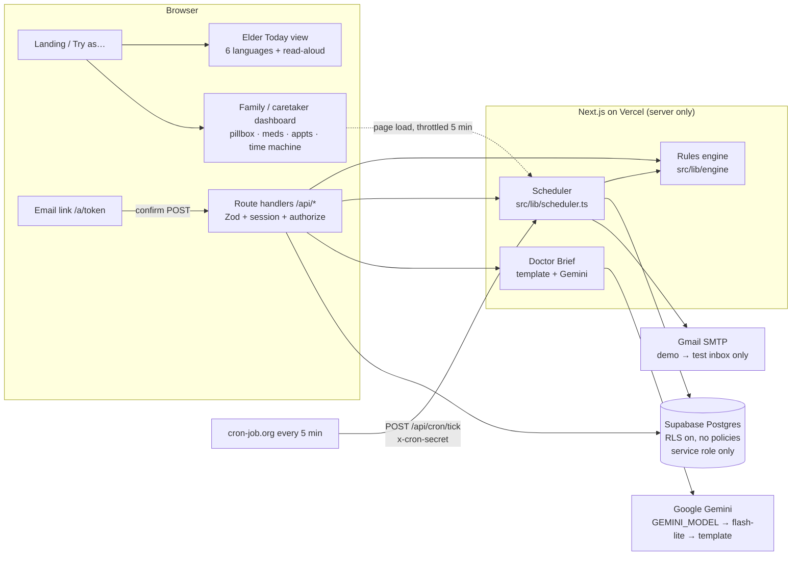

# Saathi — care that adapts

**Chosen vertical:** Elderly Care & Medication Management Platform (Catalyst × PromptWars)

> Saathi is a shared medication & appointment platform for elders, caretakers and family — it adapts to how independent the elder is, and never stops treating them as the decision-maker.

**Live:** https://saathi-theta-five.vercel.app · _साथी (Saathi) means "companion" in Hindi._

## Problem statement, line by line

> Elderly Care & Medication Management Platform — a shared ecosystem for elders, caretakers and family, with secure passcode-based access, medication schedules, adherence tracking, doctor appointments and proactive email reminders, smart and accessible, with the elder at the centre of decisions.

| Requirement (quoted)                                                                |     | How Saathi meets it                                                                                                                               | Source                                                                                                                                                                                            |
| ----------------------------------------------------------------------------------- | --- | ------------------------------------------------------------------------------------------------------------------------------------------------- | ------------------------------------------------------------------------------------------------------------------------------------------------------------------------------------------------- |
| “A shared ecosystem for elders, caretakers and family”                              | ✅  | One care circle per family; roles Elder, Caretaker, Family, Decision partner; members panel with on-duty switch                                   | [engine/permissions.ts](src/lib/engine/permissions.ts), [MembersPanel.tsx](src/components/MembersPanel.tsx), [api/members](src/app/api/members/route.ts)                                          |
| “Secure, passcode-based access”                                                     | ✅  | Circle code + per-member bcrypt passcode, 5-try lockout, per-IP rate limit, signed httpOnly session                                               | [api/auth/login](src/app/api/auth/login/route.ts), [auth/lockout.ts](src/lib/auth/lockout.ts), [auth/jwt.ts](src/lib/auth/jwt.ts)                                                                 |
| “View, add, edit and manage medication schedules”                                   | ✅  | Medicine add/edit/stop with times, dose, pill look, stock, critical flag; edits routed through the change-flow engine                             | [api/medicines](src/app/api/medicines/route.ts), [engine/changes.ts](src/lib/engine/changes.ts), [engine/schedule.ts](src/lib/engine/schedule.ts)                                                 |
| “Track adherence”                                                                   | ✅  | Dose log, 7-day pillbox, two adherence numbers (overall, and not counting the elder's own choices)                                                | [engine/adherence.ts](src/lib/engine/adherence.ts), [Pillbox.tsx](src/components/Pillbox.tsx), [api/doses/mark](src/app/api/doses/mark/route.ts)                                                  |
| “Monitor upcoming doctor appointments”                                              | ✅  | Appointments with Doctor Visit Brief and _Add to Google Calendar_                                                                                 | [api/appointments](src/app/api/appointments/route.ts), [lib/brief.ts](src/lib/brief.ts), [lib/calendar.ts](src/lib/calendar.ts)                                                                   |
| “Proactive email reminders for missed medications, upcoming doses and appointments” | ✅  | Scheduler every 5 min: T-10 reminders, missed-dose escalation ladder per mode, appointment 24 h / 2 h, single-use action links                    | [lib/scheduler.ts](src/lib/scheduler.ts), [engine/escalation.ts](src/lib/engine/escalation.ts), [email/templates.ts](src/lib/email/templates.ts), [api/cron/tick](src/app/api/cron/tick/route.ts) |
| “Smart, accessible, reliable, collaborative”                                        | ✅  | Reason-aware escalation, double-dose guard, refill forecast, change proposals, read-aloud elder view in 6 languages, Lighthouse accessibility 100 | [engine/doseGuard.ts](src/lib/engine/doseGuard.ts), [engine/stock.ts](src/lib/engine/stock.ts), [ElderToday.tsx](src/components/ElderToday.tsx), [i18n](src/i18n)                                 |
| “The elder remains at the centre of decisions”                                      | ✅  | Independent mode: the elder approves every change; “I chose to skip” respected without alarms; every change in the audit trail                    | [engine/changes.ts](src/lib/engine/changes.ts), [api/proposals/[id]](src/app/api/proposals/[id]/route.ts), [audit page](src/app/circle/[id]/audit/page.tsx)                                       |

Honest scope: a hackathon prototype, **not a certified medical device**; the doctor decides.

## Try it in 60 seconds

1. Open the live link → **Try the demo as…** and pick **Kamala** (68, Independent), **Priya** (daughter), **Nurse Lakshmi** (caretaker), **Joseph** (84, Supported) or **Ravi** (Joseph's decision partner). One click, no passcode.
2. **Real passcode sign-in:** `/signin` → circle code **`DEMO`** → pick anyone → passcode **`1234`**. (5 wrong tries lock that person for 15 minutes.)
3. As Kamala: tap **I took it** or **Not now** → a reason. Switch language (English, हिन्दी, தமிழ், తెలుగు, ಕನ್ನಡ, മലയാളം) and try **Read aloud**.
4. As Priya: watch the 7-day pillbox, change a medicine (it becomes a request Kamala must approve), open **Doctor Visit Brief** on an appointment.
5. **⏩ Time machine** (on the dashboard, demo circle only): _Kamala missed 8 AM_ / _Joseph missed 1 PM_ replays each mode's escalation ladder with real emails (to a test inbox only) and in-app email previews; _Run scheduler now_; _Reset demo_.
6. Or **Create your own care circle** at `/create`.

> **Demo credentials are public on purpose.** Circle code `DEMO` / passcode `1234` only opens the fictional demo circle (made-up people, `@example.invalid` emails, mail goes to a test inbox). The passcode is bcrypt-hashed at seed time ([`src/lib/demo/seed.ts`](src/lib/demo/seed.ts)); real circles choose their own passcodes. No real secret, key or token is in the repo or its git history (checked against every value in `.env.local`).

## Problem statement → feature

| PS requirement                                                       | Saathi feature                                                                                                                                                   |
| -------------------------------------------------------------------- | ---------------------------------------------------------------------------------------------------------------------------------------------------------------- |
| Shared ecosystem: elder, caretakers, family                          | Care circle per family with roles: Elder, Caretaker, Family, Decision partner; members panel with on-duty toggle                                                 |
| Secure, passcode-based access                                        | Per-member passcode (bcrypt), circle code, 5-try → 15-min lockout, signed httpOnly session, rate-limited circle creation                                         |
| View/add/edit/manage medication schedules                            | Medicine CRUD (times, dose, pill look, stock, critical flag) routed through the change-flow engine                                                               |
| Track adherence                                                      | Dose log, two adherence numbers (overall and excluding the elder's own choices), 7-day pillbox                                                                   |
| Monitor upcoming doctor appointments                                 | Appointments + per-appointment **Doctor Visit Brief** (template + Google Gemini)                                                                                 |
| Proactive email reminders: missed meds, upcoming doses, appointments | Scheduler every 5 min: upcoming dose (T-10), missed-dose escalation ladder, appointment 24 h and 2 h, change-request emails; one-click signed single-use links   |
| Smart, accessible, reliable, collaborative                           | Autonomy modes, reason-aware escalation, change proposals, double-dose guard, refill forecast, read-aloud elder view in 6 languages, emergency card, audit trail |
| Elder remains at the centre of decisions                             | Elder approves changes (Independent), "I chose to skip" respected without alarms, every change visible to them and in the audit trail                            |

## Approach and logic

All decisions live in a pure, framework-free rules engine: [`src/lib/engine/`](src/lib/engine) (no I/O, table-driven tests).

### Autonomy modes

| Mode          | Who                 | Who can mark doses                         | Medicine changes                                             | Missed-dose escalation                             |
| ------------- | ------------------- | ------------------------------------------ | ------------------------------------------------------------ | -------------------------------------------------- |
| `independent` | Sharp, uses a phone | Elder (others too, logged)                 | Proposal → **elder approves**                                | Elder T+30 → caretaker on duty T+60 → family T+120 |
| `assisted`    | Some forgetfulness  | Elder or others (logged)                   | Applied now; elder gets a plain-language "What changed" card | Elder + caretaker T+20 → family T+60               |
| `supported`   | Dementia / frail    | Caretaker only (elder screen is read-only) | **Decision partner** approves                                | Caretaker T+10 → decision partner + family T+30    |

Global rules: a change marked **doctor's instruction** always applies at once; escalation stops for everyone the moment anyone marks the dose or clicks "I've handled it"; a critical medicine escalates as _urgent_ from the first step.

### Missed-dose reasons

| Reason             | What happens                                                                      |
| ------------------ | --------------------------------------------------------------------------------- |
| Ran out            | Refill task for the member on duty — no alarm                                     |
| Side effect        | Gentle note to caretaker, flagged in the Doctor Brief                             |
| Forgot / no answer | The mode's escalation ladder                                                      |
| Chose to skip      | Respected, no escalation (a critical medicine → one gentle note to the caretaker) |
| Not feeling well   | Gentle note to caretaker, flagged in the Doctor Brief                             |

Engine modules: `permissions.ts` (`canPerform(role, mode, action)`), `escalation.ts` (`nextEscalationStep`), `changes.ts` (`resolveChangeFlow`), `doseGuard.ts` (double dose / too early), `stock.ts` (refill ≤ 3 days), `adherence.ts` (two numbers), `schedule.ts` (IST expansion across midnight).

## Architecture



**How it works:** every request is server-side. A signed session cookie identifies the member; each mutation reloads the member from the database, checks circle membership, then asks the engine (`authorize` → `canPerform`) before touching data, and appends to the audit log. The scheduler (cron + throttled page-load check) materialises doses, sends T-10 reminders, walks the escalation ladder with an optimistic lock so two ticks never double-send, and sends appointment reminders.

## Security

| #   | Control                                                                                                                                               | Where                                                                                                                                                                          |
| --- | ----------------------------------------------------------------------------------------------------------------------------------------------------- | ------------------------------------------------------------------------------------------------------------------------------------------------------------------------------ |
| 1   | No secrets in code; `.env.example` only; server-only env, validated at startup; no `NEXT_PUBLIC_` secrets                                             | [`src/lib/env.ts`](src/lib/env.ts), [`.env.example`](.env.example), [`.gitignore`](.gitignore)                                                                                 |
| 2   | Passcodes bcrypt cost 10, per member; 5 failures → 15-min lockout; generic errors; dummy hash for unknown ids                                         | [`src/lib/auth/lockout.ts`](src/lib/auth/lockout.ts), [`src/app/api/auth/login/route.ts`](src/app/api/auth/login/route.ts)                                                     |
| 3   | Session: HS256 JWT in httpOnly, Secure, SameSite=Lax cookie, 12 h, audience-scoped                                                                    | [`src/lib/auth/jwt.ts`](src/lib/auth/jwt.ts), [`src/lib/auth/session.ts`](src/lib/auth/session.ts)                                                                             |
| 4   | Server-side authorization on every mutation: membership (no IDOR, 404 for other circles), elder scoping, engine permission                            | [`src/lib/auth/guard.ts`](src/lib/auth/guard.ts), [`src/lib/auth/access.ts`](src/lib/auth/access.ts), [`src/lib/engine/permissions.ts`](src/lib/engine/permissions.ts)         |
| 5   | Zod on every input: lengths, HH:mm, stock/age ranges, uuid ids, 16–32 KB body cap                                                                     | [`src/lib/validation.ts`](src/lib/validation.ts), [`src/lib/http.ts`](src/lib/http.ts)                                                                                         |
| 6   | Gemini output untrusted: data sent as JSON data, Zod-validated, length-capped, rendered as text, template fallback                                    | [`src/lib/brief.ts`](src/lib/brief.ts), [`src/lib/brief-server.ts`](src/lib/brief-server.ts)                                                                                   |
| 7   | Email links: signed, ≤ 12 h, single-use (atomic DB consume), scoped, opaque ids only; GET only shows a confirm button so mail scanners can't use them | [`src/lib/action-links.ts`](src/lib/action-links.ts), [`src/app/a/[token]/page.tsx`](src/app/a/[token]/page.tsx), [`src/app/api/action/route.ts`](src/app/api/action/route.ts) |
| 8   | Cron endpoint: `x-cron-secret`, constant-time compare                                                                                                 | [`src/lib/cron-auth.ts`](src/lib/cron-auth.ts), [`src/app/api/cron/tick/route.ts`](src/app/api/cron/tick/route.ts)                                                             |
| 9   | Append-only audit log (app only inserts; DB trigger blocks UPDATE)                                                                                    | [`src/lib/audit.ts`](src/lib/audit.ts), [`supabase/migrations/001_init.sql`](supabase/migrations/001_init.sql)                                                                 |
| 10  | Security headers: CSP, X-Frame-Options DENY, nosniff, Referrer-Policy, Permissions-Policy, HSTS                                                       | [`next.config.ts`](next.config.ts)                                                                                                                                             |
| 11  | RLS enabled on every table with **no policies**; table privileges granted only to `service_role`, revoked from `anon`/`authenticated`                 | [`001_init.sql`](supabase/migrations/001_init.sql), [`002_grants.sql`](supabase/migrations/002_grants.sql)                                                                     |
| 12  | Rate limits: circle creation 5/h per IP + global 60/h; per-member login lockout                                                                       | [`src/lib/rate-limit.ts`](src/lib/rate-limit.ts), [`src/app/api/circles/route.ts`](src/app/api/circles/route.ts)                                                               |
| 13  | Demo data fictional (`@example.invalid`); demo emails only to `DEMO_EMAIL_SINK`; demo controls refuse non-demo circles                                | [`src/lib/demo/seed.ts`](src/lib/demo/seed.ts), [`src/lib/email/send.ts`](src/lib/email/send.ts), [`src/app/api/demo/route.ts`](src/app/api/demo/route.ts)                     |

See [SECURITY.md](SECURITY.md). `npm audit --omit=dev`: 0 vulnerabilities (7 moderate in dev-only ESLint tooling).

## Testing

`npm test` → **342 tests, 12 files, all passing** · `npm run test:coverage` → v8 coverage with thresholds (CI fails below them)

| Coverage (v8, `src/lib`)                  | Statements | Branches | Functions | Lines |
| ----------------------------------------- | ---------- | -------- | --------- | ----- |
| Rules engine `lib/engine` (threshold 95%) | 100%       | 99.1%    | 100%      | 100%  |
| Auth `lib/auth`                           | 63.3%      | 63.6%    | 58.8%     | 66.7% |
| All of `src/lib` (threshold 40%)          | 47.2%      | 45.4%    | 50%       | 48.1% |

API routes are covered by integration tests ([src/app/api/**tests**/routes.test.ts](src/app/api/__tests__/routes.test.ts)) that run the real handlers against a fake database: sign-in, mark-dose, cron and change-proposal, each with a happy path, an auth failure and a validation failure. (Vitest, table-driven):

- **Engine:** full role × mode × action permission matrix (72), escalation per mode × reason × critical, already-notified roles, resolved stops all, change flow incl. doctor-instruction bypass, double-dose guard, refill forecast, adherence incl. "chose to skip", schedule expansion across IST midnight.
- **Security:** action token expired / reused / tampered / wrong secret / oversized / session-token-as-action rejected; session expiry; lockout after 5 tries; circle A member can't read or edit circle B; cron route rejects missing/wrong secret (401).
- **Validation:** bad times, negative/huge stock, oversized strings, circle creation (duplicate names, two elders, bad passcodes, phone, blood group), circle codes.
- **Doctor Brief:** template rules per reason, and fallback when Gemini throws, times out, returns non-JSON or the wrong shape.
- **Email templates** (HTML escaping, buttons per role), **rate limiter**, **dictionaries** (all 6 languages, every key, same placeholders).

Manual: playwright-cli runs at 375 px and 1440 px for the demo flows, time machine, email link redemption, passcode sign-in and circle creation. Playwright e2e specs were cut for time.

## Accessibility

Semantic landmarks, skip link, visible focus rings, labels on every input, `aria-live` for results and errors, keyboard-focusable pillbox cells with full aria-labels (state is never colour-only: each has a glyph), touch targets ≥ 44–48 px, elder view text ≥ 22 px, `lang` switches with the chosen language, read-aloud falls back to "Voice not available on this device", decorative images `alt=""`, and all motion respects `prefers-reduced-motion` (hydration-safe; Framer Motion `reducedMotion="user"`). Lighthouse results: [`docs/`](docs).

## Google services used

- **Google Gemini** (`@google/genai`, model from `GEMINI_MODEL`, falling back to `gemini-3.5-flash-lite`, then to a deterministic template): writes the Doctor Visit Brief in plain English and in the elder's language, labelled "Generated with Google Gemini" — [lib/brief-server.ts](src/lib/brief-server.ts).
- **Google Calendar**: every appointment has an _Add to Google Calendar_ link (calendar template URL, no API key, opens in a new tab) — [lib/calendar.ts](src/lib/calendar.ts), [CalendarLink.tsx](src/components/CalendarLink.tsx).
- **Google Fonts** (via `next/font`, self-hosted at build time): Fraunces, Inter, Caveat, Kalam and Noto Sans for Devanagari, Tamil, Telugu, Kannada and Malayalam — [app/layout.tsx](src/app/layout.tsx).
- Gmail SMTP for email reminders.
- Deployable to **Google Cloud Run** (see below).

## Assumptions

- A hackathon prototype, **not a certified medical device**; the brief summarises what the circle recorded, the doctor decides.
- Family/caretaker dashboards are English; the elder view is in 6 languages. Translations are **AI-assisted** and still need a native-speaker check.
- All times are IST (Asia/Kolkata).
- Email via Gmail SMTP; the demo circle never emails real people.
- One care circle can hold several elders; each member belongs to one circle.

## Local setup

```bash
npm install
cp .env.example .env.local   # fill in Supabase, secrets (32+ random chars), Gmail app password, Gemini key
```

Run `supabase/migrations/001_init.sql`, `002_grants.sql`, `003_circle_code.sql` in the Supabase SQL editor, then:

```bash
npm run seed    # fictional demo circle (code DEMO, passcode 1234)
npm run dev
npm test
```

Scheduler in production: cron-job.org → `POST https://<your-app>/api/cron/tick` every 5 min with header `x-cron-secret: <CRON_SECRET>`.

## Design

Design system: [DESIGN.md](DESIGN.md) — cream, ink, deep green and saffron with sage/peach gradients; Fraunces (display), Inter (UI), Caveat + Kalam (script accents); pill buttons, tinted two-layer shadows, a hand-drawn saffron "thread". Reference study and three critique rounds: [docs/refs/NOTES.md](docs/refs/NOTES.md), [docs/refs/CRITIQUE.md](docs/refs/CRITIQUE.md). The elder view's sky follows the IST time of day (`?sky=morning|afternoon|evening` previews the others).

## Photo credits

Photographs of Indian families are from [Unsplash](https://unsplash.com) under the Unsplash Licence and are used as **demo personas — not real users**: Richard Saunders (Kamala), Pranav Rasal (Joseph), Ashwini Chaudhary (Monty) (Priya), Fotos (Lakshmi), Wilfred Sequeira (Ravi), Trương Tuyết Ly (hands), Frederick Shaw (elders laughing), Miles Burke (pill organiser), National Cancer Institute (doctor visit), WorldSikhOrg (family at home). Cropped and converted to WebP (< 150 KB each) in `public/images/`.

## Deploy to Google Cloud Run

The live app runs on Vercel; the same build also runs as a container. A [Dockerfile](Dockerfile) is included (docs only — the Vercel deploy is unchanged).

```bash
gcloud builds submit --tag asia-south1-docker.pkg.dev/PROJECT/saathi/web
```

```bash
gcloud run deploy saathi --image asia-south1-docker.pkg.dev/PROJECT/saathi/web --region asia-south1 --allow-unauthenticated --set-secrets SUPABASE_SERVICE_ROLE_KEY=supabase-key:latest,SESSION_SECRET=session-secret:latest,ACTION_LINK_SECRET=action-secret:latest,CRON_SECRET=cron-secret:latest,GMAIL_APP_PASSWORD=gmail-app-password:latest,GEMINI_API_KEY=gemini-key:latest --set-env-vars SUPABASE_URL=https://YOUR.supabase.co,GMAIL_USER=you@gmail.com,GEMINI_MODEL=gemini-3.8-flash,APP_BASE_URL=https://YOUR-SERVICE.run.app,DEMO_EMAIL_SINK=you@gmail.com
```

Use **asia-south1 (Mumbai)** to sit next to the Supabase database, keep secrets in Secret Manager, and point cron-job.org at `https://YOUR-SERVICE.run.app/api/cron/tick` (or use Cloud Scheduler with the `x-cron-secret` header).

## Continuous integration

[.github/workflows/ci.yml](.github/workflows/ci.yml) runs on every push and pull request: `npm ci` → lint → typecheck → tests with coverage thresholds → production build. [Dependabot](.github/dependabot.yml) checks npm and GitHub Actions weekly.
